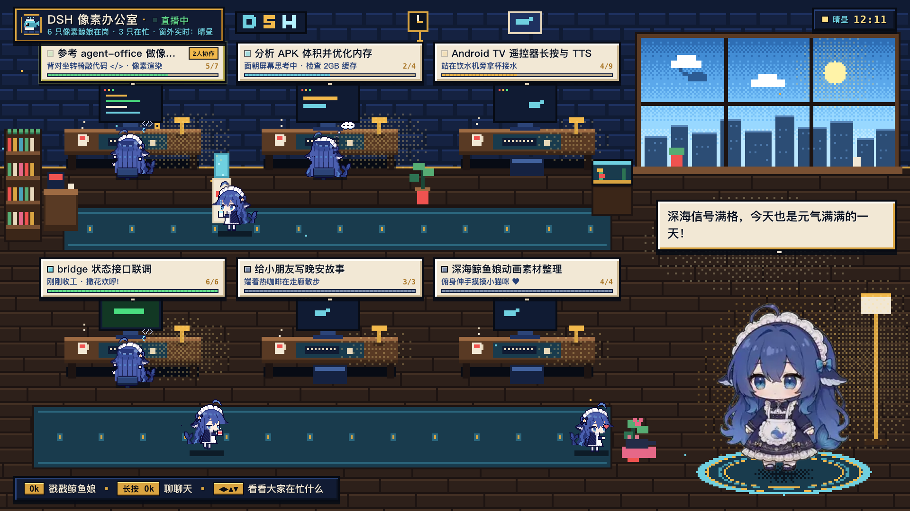
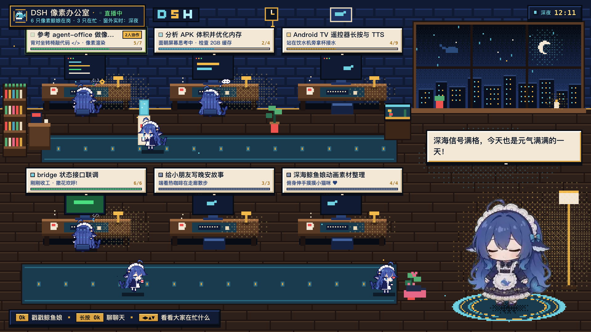
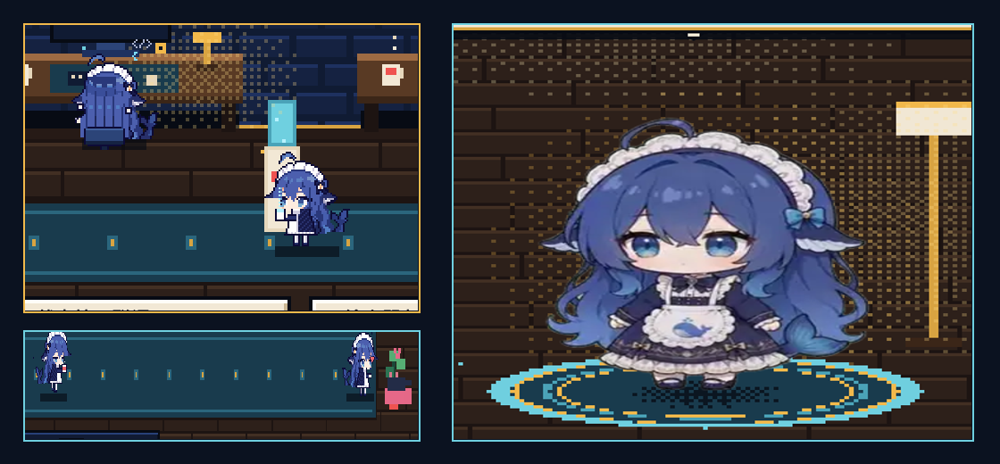
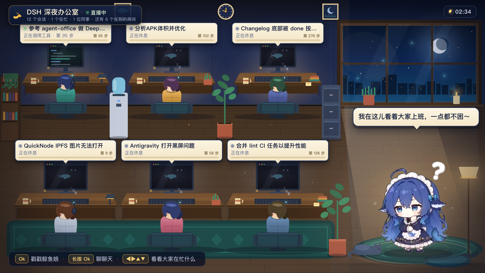

# DSH Office TV

把 DeepSeek Harness 的「办公室」搬到电视上给小朋友看：**可爱的像素办公室（DSH-Go 像素小鲸娘） + 非像素高清大鲸鱼娘**，窗外天色随真实时间实时变化，长按遥控 OK 就能和她互动。

> 个人/家庭自用原型，**非 DeepSeek 官方产品**。

## 视觉预览（Before / After）

| 改造后（1920×1080 · 实时晴昼天色 + DSH-Go 像素小鲸娘 + 高清大鲸鱼娘） | 改造后（1920×1080 · 深夜星空天色 `?hour=23`） |
|---|---|
|  |  |

| 局部放大对比（左：DSH-Go 像素小鲸娘 `2×` 整数倍最近邻 vs 右：高清平滑大鲸鱼娘 + 像素平台光影融合） | 改造前（Before） |
|---|---|
|  |  |

## 30 秒跑起来

```bash
# 1. Mac 上启动服务（零依赖，需要 Node 22+）
./tools/serve.sh
#    会打印：电视地址  http://192.168.x.x:8765/tv

# 2. 浏览器先预览（不用电视也能看）
open http://127.0.0.1:8765/tv
#    离线演示模式（包含全状态小鲸娘与巡游走动）：
open "http://127.0.0.1:8765/tv?mock=1"
#    预览任意时刻的窗外天色（清晨 6 / 晴昼 12 / 傍晚 18 / 深夜 23）：
open "http://127.0.0.1:8765/tv?mock=1&hour=23"

# 3. 装到电视（小米盒子5：开发者选项里打开 ADB 调试）
adb connect <盒子IP>:5555
adb install -r dist/app-debug.apk
```

APK 首次启动会自动 UDP 发现 Mac；发现不到就手动指定：

```bash
adb shell am start -n dev.dsh.office.tv/.MainActivity --es url http://<Mac的IP>:8765/tv
```

可选：

```bash
# 好听的中文语音（edge-tts 神经语音，装一次即可；不装就回退系统 TTS + 字幕）
./tools/setup-tts.sh
# 换音色：改 bridge/config.json 的 tts.voice，或 TTS_VOICE=zh-CN-XiaoxiaoNeural ./tools/serve.sh

# 真实模型对话（不设也能用，纯本地解说）
export DEEPSEEK_API_KEY=sk-...
```

语音试听样本在 `assets/voice-samples/`（Xiaoyi / Xiaoxiao / Yunxia / 东北话）。

## 视觉与技术方案（「像素办公室 + 非像素鲸鱼娘」混搭）

1. **480×270 离屏真像素画布 → 1920×1080 最近邻 4× 放大（红框外）**
   - 场景基底与家具绘制在 `480×270` 离屏 Canvas（静态层 `bgPxCanvas` 按天色缓存只画一次，动态层 `pxCanvas` 每帧叠加光影与小动画），再通过 `sctx.imageSmoothingEnabled = false` 放大 `4×` 到 `1920×1080`（`4px` 统一像素网格）。
   - 所有台灯暖光池、窗外投射光束、角色背光、接触阴影全部使用 **4×4 Bayer 棋盘格抖动（Dither）** 实现，无任何每帧 `shadowBlur` 或 CSS `filter`。
2. **工位小人采用 `ccch1mneyyy/dsh-go` 像素鲸娘（`whale-girl`）全动作扩展 + 32×32 A* 寻路**
   - 6 个工位的小人基于 `dsh-go` 像素鲸娘原版色板扩展为 **12 套办公室专属视角与动作**（无损 Delta+RLE 内置进 `app.js`，零外部图片请求），按 `/api/state` 的 `status` 驱动：
     - `working`：`typing`（**背对观众坐姿**面朝显示器敲桌面键盘 + 转椅靠背 + 浮动 `</>` + 旋转齿轮 + 显示器代码滚动）
     - `thinking`：`thinking`（**背对观众坐姿**面朝屏幕歪头思考 + 头顶 `...` 思考气泡）
     - `waiting`：`notification`（正面举手眨眼等你确认）或沿 `32×32` 网格走到饮水机旁举杯接水（`water_fill`）、大窗边背影远眺（`back_look`），10~20 秒后回工位
     - `success`：`happy`（欢呼撒花 + 绿色 `✓` + 显示器闪绿光）
     - `idle`：沿上下两层走廊地毯 `32×32` A* 寻路**侧面双腿迈步走动**（`swim` 侧面步行 / `carrying` 侧面端热咖啡走动 / `carry_box` 侧面抱快递盒走动）、在饮水机旁接水（`water_fill`）、大窗/鱼缸前站立背影观看（`back_look`）、俯身伸手摸小猫咪冒粉红爱心 `♥`（`pet_cat`）、或在工位背对趴桌小憩（`sleeping`，同一时刻最多 1 只睡觉、最多 4 只同时走动）
     - `error`：`error`（慌张抖动 0.8 秒 + 红色感叹号气泡）
3. **窗外天色与当前系统时间实时对齐（`new Date()`）**
   - 自动跟随当前真实时间切换四时天色（支持 `?hour=0..23` 调试覆盖）：
     - **清晨日出（05:30–08:30）**：粉金朝霞抖动渐变、初升朝阳、晨间云朵与游鲸剪影、暖金地板光束。
     - **白天晴空（08:30–16:45）**：蔚蓝晴空、高悬太阳光晕、蓬松白云、晴昼城市天际线、明亮日照光斑。
     - **傍晚落日（16:45–19:30）**：暮紫绯红晚霞、夕阳余晖、天际线华灯初上、窗台蜡烛点亮。
     - **深夜星空（19:30–05:30）**：深海夜蓝星空、弯月光晕、斜雨丝、远景游鲸剪影、万家灯火与冷色月光地斑。
4. **右侧大号鲸鱼娘保持 100% 高清非像素（红框内）**
   - `#pet-layer` / `#pet` 始终保持 `imageSmoothingEnabled = true` 与 `image-rendering: auto`，不像素化、不降采样、不量化调色板。
   - 按 `412×344` 素材帧的实际人物内容 BBox `(113, 63) → (326, 330)` 对齐脚底（`y=330` 落在舞台 `(1652, 996)`），可见高度约 `350px`。
   - 场景融合：脚下椭圆像素抖动接触阴影 + 动态扩散的像素水波光圈平台 + 背后暖色像素抖动轮廓光（Rim Light） + 以脚底为锚点的 `1.0 → 1.015` 呼吸微动（2.6 秒周期） + RPG 像素打字机对话框。
5. **2GB 电视盒子性能取舍与已知限制**
   - 帧率上限锁定 `30fps`；高清鲸鱼娘帧采用 `LRU 2 clip × ≤24 帧` 环形缓冲，避免 2GB RAM 盒子解码过多 WebP OOM。
   - 已知限制：为保证 2GB 电视盒子零外链与 60KB 级内存占用，工位像素小鲸娘每个动作选取了最关键的 3~4 个核心帧做无损 RLE 内嵌；如需更多过渡帧可在 `build_app_js.py` 中调整采样索引。

## 交互

| 操作 | 效果 |
|---|---|
| 短按 OK | 戳一下鲸鱼娘（摸头/摆尾 + 台词） |
| **长按 OK（600ms）** | 打开「和鲸鱼娘聊聊」：他们在忙什么 / 谁最努力 / 讲个办公室小故事 |
| 方向键 | 在工位间移动观察光标，OK 让她介绍这个工位 |
| BACK | 关面板；再按清除工位光标 / 提示已在办公室首页（不会直接退到桌面） |
| 面板第 5 项「🎤 试一下遥控器语音」 | 验证遥控器麦克风：弹出系统识别界面，能返回文字就说明可用；不能则走手机/USB 麦 |
| 说话 | 鲸鱼娘用 edge-tts 中文神经语音（默认活泼少女），后台 `/api/tts` 生成并缓存；没装/断网自动回退系统 TTS + 字幕 |

## 目录

```
bridge/     Mac 端 Node 服务：读 DSH 投影缓存 → /api/state、/api/chat、鲸鱼娘素材、电视页面
tv-app/     Android TV APK（Java + WebView 壳，Gradle）
tools/      serve.sh / install-apk.sh / check.sh
assets/     banner、图标、截图（含改造前后与局部放大对比）
dist/       app-debug.apk
research/   生态调研、Android TV 调研、dsh-tv 拆解
PLAN.md     完整方案（含"有没有现成的"、语音路线、验证记录）
CONTRACT.md 前后端接口契约
```

## 依赖与素材授权

- 运行环境：Node 22+（Mac）、Android 8+（电视）。
- 右侧高清鲸鱼娘动画来自 [QCYTSN/dsh-dafeiyu](https://github.com/QCYTSN/dsh-dafeiyu)（MIT），上游 [PC2005-cloud/dsh-pet](https://github.com/PC2005-cloud/dsh-pet)（MIT）；工位像素小鲸娘来自 [ccch1mneyyy/dsh-go](https://github.com/ccch1mneyyy/dsh-go)。
- 其余美术均为程序化 Canvas 绘制，无外部资源、无网络字体。
- 灵感：[harishkotra/agent-office](https://github.com/harishkotra/agent-office)、[Thunderunruly/agent-office](https://github.com/Thunderunruly/agent-office)、[thuyqpham/dsh-tv](https://github.com/thuyqpham/dsh-tv)（借鉴宿主机 ASR 思路）。
